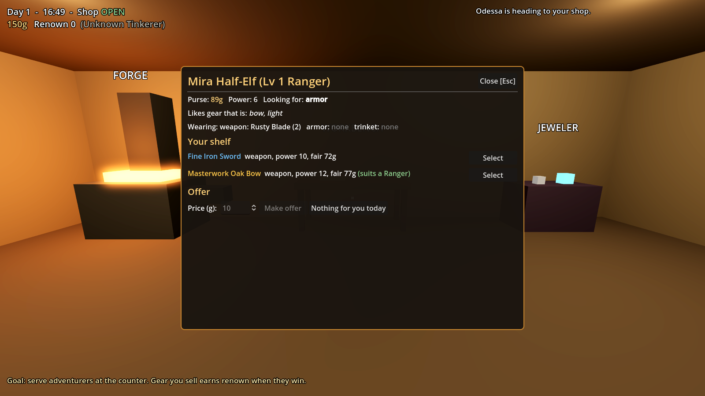

# Forge & Fortune *(working title)*

A 3D craft-and-upgrade game in the spirit of *Schedule 1*. You're not the hero: you're the **village crafter**
who forges weapons, armor and jewelry for the NPC adventurers who dive into dungeons. Equip them well,
and their victories make you famous.

> 📋 **Read [`docs/GAME_PLAN.md`](docs/GAME_PLAN.md)** for the full design, roadmap, how to get 3D art
> without modeling it yourself, and what makes the loop addictive.



*Grey-box placeholder art for now. See the game plan for how to swap in real models.*

Built with **[Godot 4.3+](https://godotengine.org/download)**, which is free, small, and scripted in GDScript (a Python-like language).

---

## Quick start

1. Download **Godot 4.3 or newer** (the standard build, not .NET) from https://godotengine.org/download
2. Open Godot → **Import** → select this folder's `project.godot` → **Import & Edit**
3. Press **F5** (or the ▶ button, top right) to play

### Controls
| Key | Action |
|---|---|
| WASD / arrows | Move |
| Mouse | Look |
| Shift | Sprint |
| Space | Jump |
| **E** / left click | Interact (stations, counter, customers, bed) |
| Space / E / click | Strike during the crafting minigames |
| Tab | Adventurer ledger |
| Esc | Close menu / pause menu (save, new game, quit) |

### How to play
1. **Craft**: walk to the Forge or Workbench and press E. Pick a recipe, then hit the gold zone three times.
   Better hits mean better quality (Crude → Common → Fine → Masterwork).
   The **Jeweler's Bench** uses a different minigame inspired by the *Starcatcher* fishing mod: a needle
   sweeps around a ring and you hit the glowing gem slots to fill a progress bar before it drains.
   Purple slots reverse the needle. Green slots fill a *Flawless* meter for +1 quality.
2. **Sell**: from 08:00, adventurers walk in and line up at the counter. Press E on the counter to serve them.
   Pick an item, set a price, make an offer. Gear matching their class (e.g. heavy gear for warriors) sells for more.
3. **Restock**: buy materials at the **Supply Order Board** (left wall). Rare materials only come from
   adventurers' dungeon loot, so buy it when they offer.
4. **Sleep** after 18:00. Overnight, every adventurer delves. The **Night Report** shows who won, who leveled up,
   who died, and how much **renown** your gear earned you.
5. **Upgrade** at the **Upgrade Lectern**: unlock the Jeweler's Bench, a signboard for more customers,
   an apprentice who crafts while you sleep, and more. Renown also unlocks new recipes.

The game auto-saves every night.

---

## Project layout

```
project.godot            Godot project config (autoloads = global singletons)
scenes/main.tscn         The one scene; everything is built in code by main.gd
data/                    ALL game content as JSON: recipes, materials, dungeons, classes, upgrades, tiers, minigame tuning
scripts/
  autoload/              Global systems (always loaded)
    event_bus.gd           Signals shared between systems
    data_db.gd             Loads data/*.json
    game_state.gd          Your gold, renown, stock, upgrades + save/load
    time_manager.gd        Day clock, shop hours
    adventurer_manager.gd  NPC roster, haggling rules, overnight dungeon simulation
  main.gd                Builds the village + shop, runs the day/night loop
  world/                 Player controller, stations, shop queue, placeholder visuals
  npc/adventurer_npc.gd  Walking adventurer body (waypoints, queue, speech bubble)
  ui/                    HUD + every menu (craft, minigame, sale, supply, upgrades, ledger, night report)
assets/models/           Drop .glb models here to replace grey boxes (see below)
tests/                   Headless logic tests, economy simulation, scene smoke test
docs/GAME_PLAN.md        Design doc & roadmap
```

### Adding content (no coding)
- **New item**: add an entry to `data/recipes.json` (station, slot, power, value, renown needed, tags, inputs).
- **New dungeon**: add to `data/dungeons.json` (difficulty, gold, loot).
- **New material**: add to `data/materials.json` (`buyable: false` = dungeon loot only).

### Replacing placeholder art
Put a model named `<key>.glb` in `assets/models/` and it's used automatically instead of the grey box,
e.g. `forge.glb`, `adventurer_warrior.glb`, `house.glb`. Full list of keys in
[`docs/GAME_PLAN.md`](docs/GAME_PLAN.md#how-art-plugs-into-this-project-no-code-changes).

---

## Tests

From this folder, with the Godot executable on your PATH:

```bash
godot --headless res://tests/test_runner.tscn   # logic tests + 30-day economy simulation
godot --headless res://tests/smoke_test.tscn    # boots the real scene, plays a fast day
```

(The headless run prints harmless `Parameter "m" is null` errors from the dummy renderer.)

### Exporting
If data doesn't load in an exported build, add `data/*.json` under
*Project → Export → Resources → Filters to export non-resource files*.
