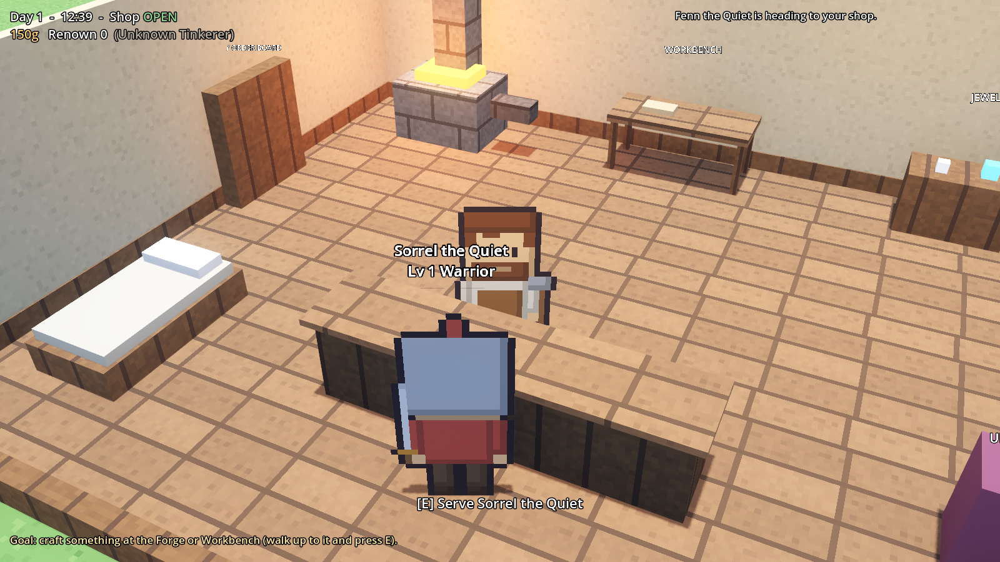
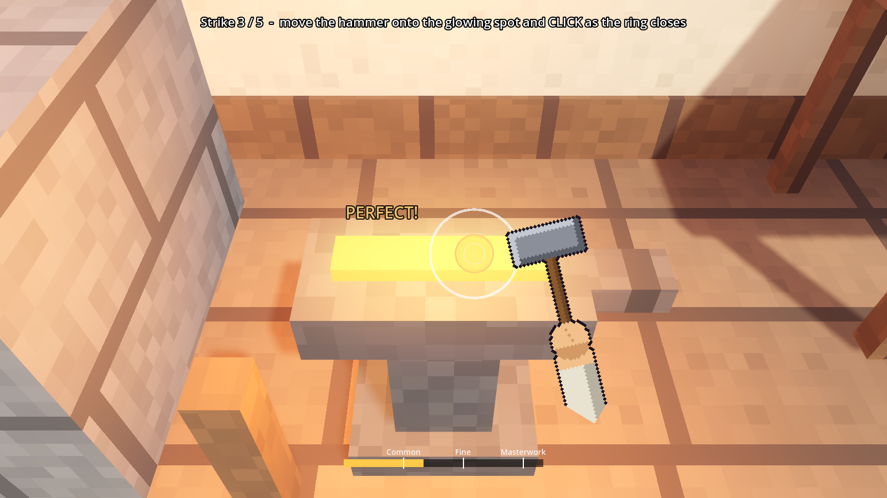
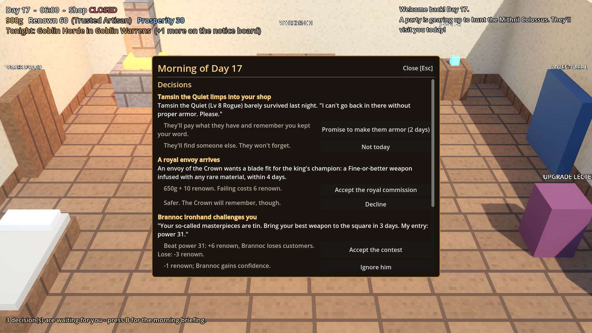
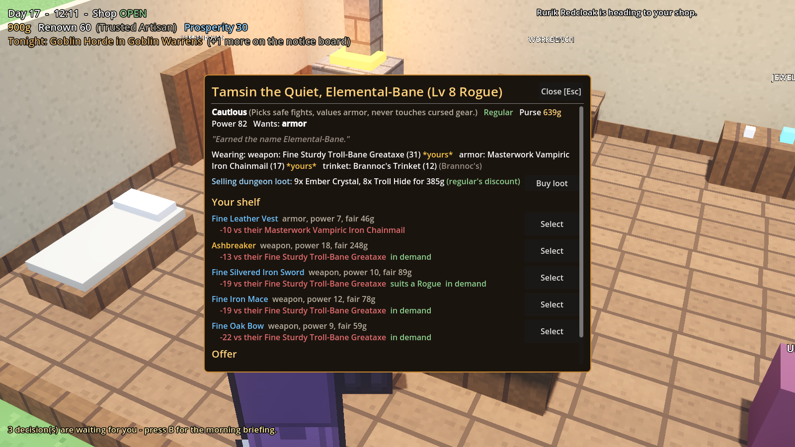
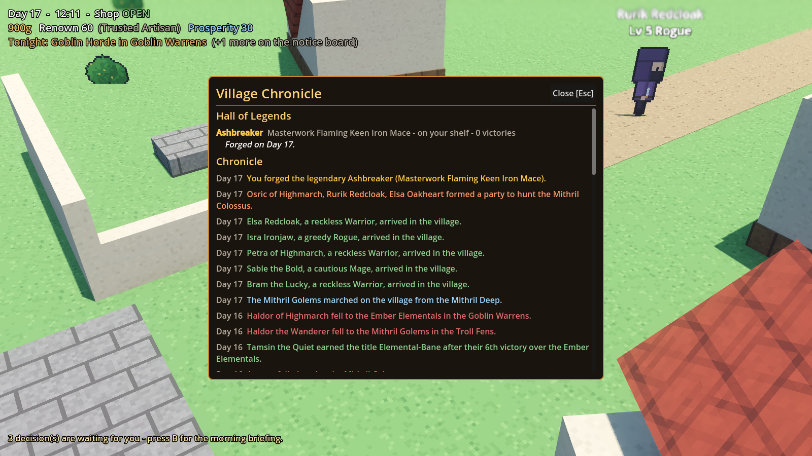

# Forge & Fortune *(working title)*

A craft-and-upgrade game in the spirit of *Schedule 1*, with 2D pixel-art characters in a 3D world (like *EthrA*). You're not the hero: you're the **village crafter**
who forges weapons, armor and jewelry for the NPC adventurers who dive into dungeons. Equip them well,
and their victories make you famous.

> 📋 **Read [`docs/GAME_PLAN.md`](docs/GAME_PLAN.md)** for the full design, roadmap, how to get 3D art
> without modeling it yourself, and what makes the loop addictive.



*Placeholder pixel art for now. See the game plan for how to swap in real art.*

| First-person anvil | Morning decisions | A hero with a history | The Chronicle |
|---|---|---|---|
|  |  |  |  |

Built with **[Godot 4.3+](https://godotengine.org/download)**, which is free, small, and scripted in GDScript (a Python-like language).

---

## Quick start

1. Download **Godot 4.3 or newer** (the standard build, not .NET) from https://godotengine.org/download
2. Open Godot → **Import** → select this folder's `project.godot` → **Import & Edit**
3. Press **F5** (or the ▶ button, top right) to play

### Controls
| Key | Action |
|---|---|
| WASD / arrows | Move |
| Mouse | Orbit camera |
| Mouse wheel | Zoom |
| F2 | Cycle the retro pixel filter |
| Shift | Sprint |
| Space | Jump |
| **E** / left click | Interact with whatever is in front of you (stations, counter, customers, bed) |
| Mouse + click | Swing the hammer at the anvil |
| Space / E / click | Strike in the workbench / jeweler minigames |
| Tab | Adventurer ledger |
| B | Morning briefing (decisions, deadlines, threats) |
| C | Village chronicle & Hall of Legends |
| Esc | Close menu / pause menu (save, new game, quit) |

### How to play
1. **Craft.** At the **Forge** you drop into a first-person view over the anvil. A pixel hand holds your
   hammer and follows the mouse. Move it onto the glowing spot on the hot metal and **click as the
   closing ring meets the spot**. *Where* and *when* both count. The Workbench uses a timing bar, and the
   Jeweler's Bench a Starcatcher-style dial.
   - **Infuse** a rare material for an affix: *Flaming* (fire), *Silvered*, *Sturdy* (never breaks),
     *Warden's* (wearer rarely dies), *Vampiric*, *Lucky*, *Mithril-forged*, or *Heroic* (from a boss
     trophy). Effects stay hidden until you experiment.
   - Excellent work can turn out **Keen** or **Cursed**. Crafting a weapon family builds **mastery**.
   - A Masterwork infused with a rare material may become a named **Legend**, with its own history.
2. **Sell.** Heroes line up at the counter. Each has a personality, a loyalty to you, memories, and a plan
   for tonight. Your shelf is sorted by how much each item helps them, with the reasons shown.
3. **Plan.** The **Notice Board** shows each dungeon's threat, any bosses, the forecast (enemies,
   weaknesses, modifiers, loot, bounties; distant rumors can change) and commissions.
4. **Sleep.** Heroes delve, level up, earn titles, break gear, die, recover lost legends and hunt bosses
   in parties. The **night report** leads with what will be remembered.
5. **Decide.** Most mornings bring a **briefing (B)** with real choices: a wounded hero begging for armor,
   rivals in a bidding war, a royal envoy, a legendary hero's challenge, Brannoc's contest, a festival,
   a stranger's blueprint, a treasure map, or monsters marching on the village.
6. **Build the village.** Contribute to restoration projects at the **Village Hall**: Watchtower,
   Chapel, Market Hall, Guild Hall and Deep Mine. Each changes the rules and appears in the world.
   You can also risk gold on caravans.
7. **Remember.** The **Chronicle (C)** holds the Hall of Legends and the village's history.

**Why it matters:** gear that hits an enemy's weakness is 30% stronger, and a weapon the enemy resists
is 30% weaker. Ignored dungeons grow dangerous: high threat raises a named **boss**, and maximum threat
brings a **raid**. Prices follow supply and demand, and the rival smith **Brannoc** sells to every hero
you don't serve. Beat him in two contests while out-shining him and he leaves town.

The game auto-saves every night.

## Project layout

```
project.godot            Godot project config (autoloads = global singletons)
scenes/main.tscn         The one scene; everything is built in code by main.gd
data/                    ALL game content as JSON: recipes, materials, dungeons, enemies, village, classes, upgrades, tiers, minigame tuning
scripts/
  autoload/              Global systems (always loaded)
    event_bus.gd           Signals shared between systems
    data_db.gd             Loads data/*.json
    game_state.gd          Your gold, renown, stock, upgrades + save/load
    time_manager.gd        Day clock, shop hours
    adventurer_manager.gd  NPC roster, haggling rules, overnight dungeon simulation
    village.gd             Forecast, commissions, merchant, tavern, gathering, prosperity, projects, caravans
    dungeons.gd            Threat, faction control, bosses, raids, lost legends
    market.gd              Dynamic prices, saturation, hero demand, the rival smith
    happenings.gd          State-driven morning events and decisions
    chronicle.gd           The village history
    simulation.gd          begin_day()/end_day(): runs every system in order (game AND tests)
  main.gd                Builds the village + shop, runs the day/night loop
  world/                 Player controller + camera, pixel sprites, stations, shop queue, retro filter
  npc/adventurer_npc.gd  Walking adventurer body (waypoints, queue, speech bubble)
  ui/                    HUD + every menu (craft, minigame, sale, supply, upgrades, ledger, night report)
assets/sprites/          Pixel-art character sheets + foliage (32x40 frames, see docs)
assets/textures/         32x32 pixel textures for the 3D world (16 px = 1 m)
assets/models/           Optional .glb models to replace furniture boxes
tools/gen_pixel_assets.py  Generates the placeholder sprites/textures
tools/gen_sounds.py        Generates the placeholder sound effects
tests/                   Headless logic tests, economy simulation, scene smoke test
docs/GAME_PLAN.md        Design doc & roadmap
```

### Adding content (no coding)
- **New item**: add an entry to `data/recipes.json` (station, slot, power, value, renown needed, tags, inputs).
- **New dungeon**: add to `data/dungeons.json` (difficulty, gold, native enemy).
- **New enemy**: add to `data/enemies.json` (weak/resist tags, loot drops).
- **New material**: add to `data/materials.json` (`buyable: false` = dungeon loot only).

### Replacing placeholder art
Overwrite any PNG in `assets/sprites/` or `assets/textures/` with real pixel art in the same layout and it's
used automatically. The sheet format and where to get art are in
[`docs/GAME_PLAN.md`](docs/GAME_PLAN.md#4-art-direction-2d-pixel-art-in-a-3d-world-ethra--hd-2d-style).

---

## Tests

From this folder, with the Godot executable on your PATH:

```bash
godot --headless res://tests/test_runner.tscn   # core logic tests + 30-day economy simulation
godot --headless res://tests/systems_test.tscn  # living-world systems, exploit guards, 60-day bot campaign
godot --headless res://tests/smoke_test.tscn    # boots the real scene: anvil, menus, a day, 4 nights, save/load
```

(The headless run prints harmless `Parameter "m" is null` errors from the dummy renderer.)

### Exporting
If data doesn't load in an exported build, add `data/*.json` under
*Project → Export → Resources → Filters to export non-resource files*.
